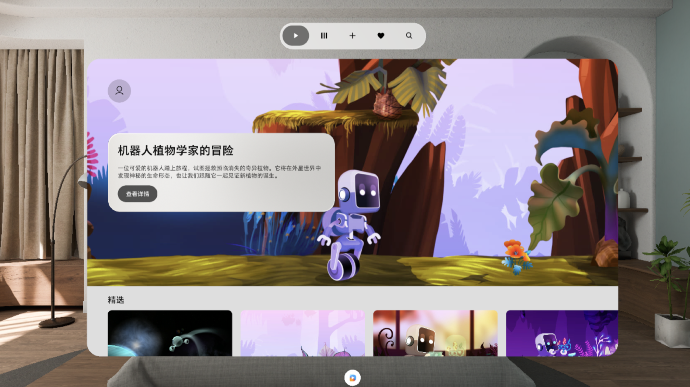
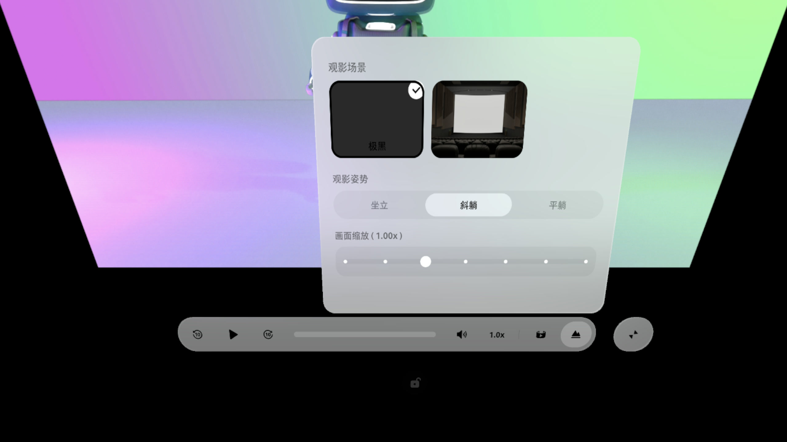
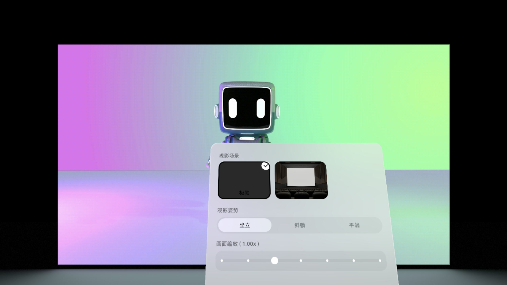
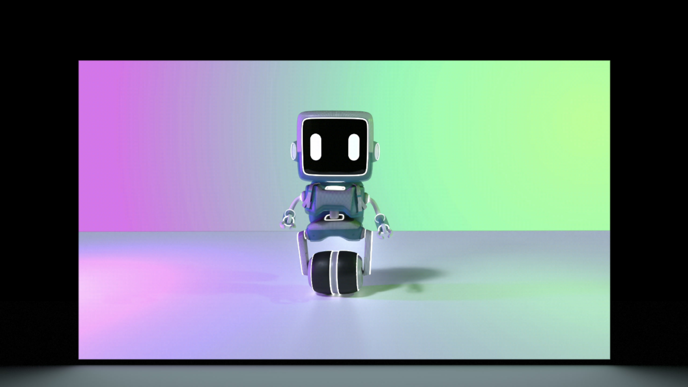
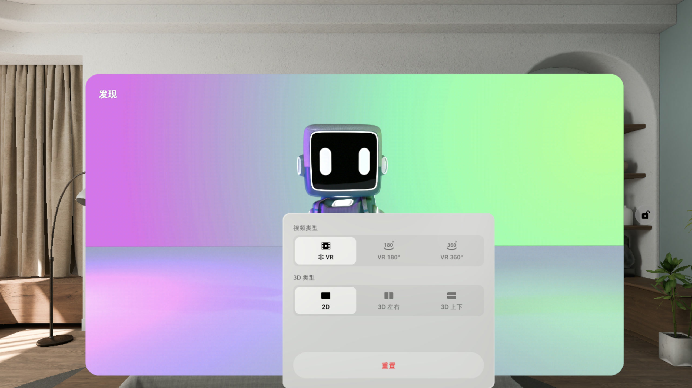
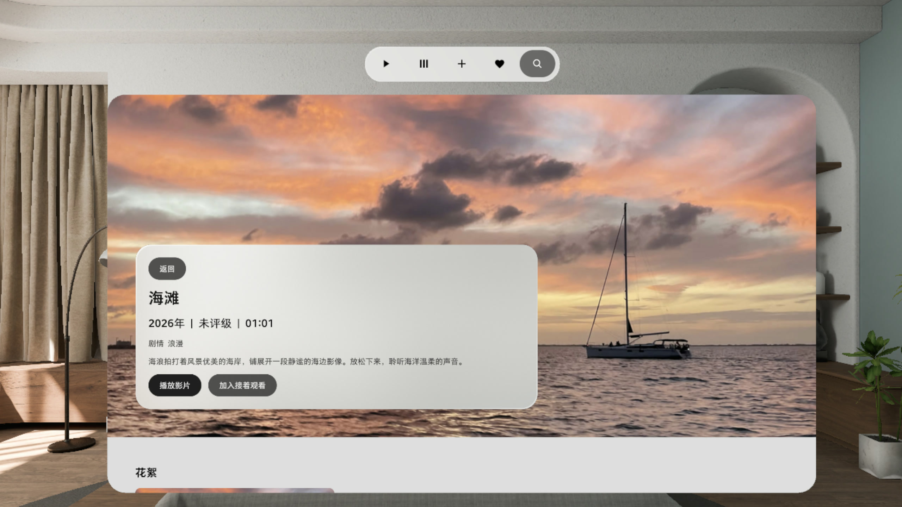
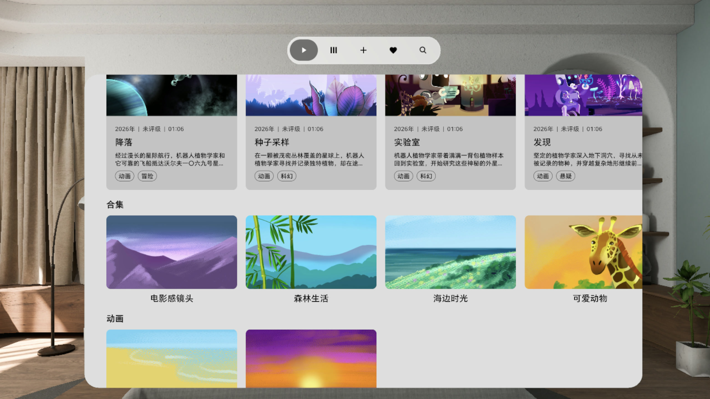
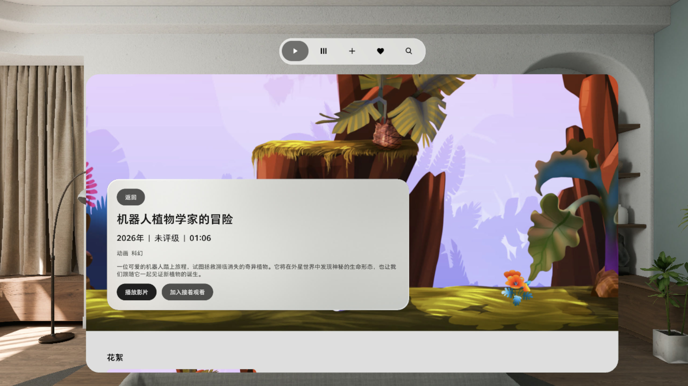

# PicoSpatialVideoPlayer

A spatial video experience built for Vibe Lab.

PicoSpatialVideoPlayer is a sample application built for PICO spatial
computing devices. It uses the PICO Spatial SDK to present a browsable video
catalog in spatial windows and PICO MediaPack to provide windowed and Full Space
playback.

The application UI is currently provided in Simplified Chinese.



## Demo

[](images/20261017151053170.mp4)

[Watch the 40-second demo video (MP4, 21 MB)](images/20261017151053170.mp4)

## Screenshots

| Cinema settings | Theater position |
| --- | --- |
|  |  |

| Full Space playback | Video format selection |
| --- | --- |
|  |  |

| Beach video details | Video library |
| --- | --- |
|  |  |

| Adventure video details |
| --- |
|  |

## Features

- Spatial catalog window with Watch Now, Library, category, detail, and search
  views
- Genre filtering and metadata for each video, including cast and crew
- Persistent Up Next queue backed by Android `SharedPreferences`
- Playback from packaged Android resources and remote video URLs
- Dedicated, resizable playback window with standard playback controls
- Playback speed selection from 0.5x to 2.0x
- Full Space playback through a PICO Spatial SDK stage
- Return routing from the player to the selected video's detail page

The New and Favorites tabs are present as placeholders and do not yet contain
functional content.

## Technology

- Kotlin and Android
- PICO Spatial SDK 6.1.5
- PICO Spatial UI with Jetpack Compose
- PICO MediaPack 0.3.9-rc.0
- Android Gradle Plugin 8.11.0
- Android API 35

For Spatial SDK setup, platform concepts, API guides, and supported devices,
see the [PICO Developer Documentation](https://developer-cn.picoxr.com/document/).

## Project Structure

```text
app/src/main/java/com/picoxr/destinationvideo/
├── mainApp.kt                  Spatial windows and Full Space stage
├── MainActivity.kt            Main spatial launch activity
├── DestinationPlayerActivity.kt
└── destination/
    ├── DestinationApp.kt      Catalog UI and navigation
    ├── DestinationCatalog.kt  Video metadata and Up Next persistence
    └── DestinationPlayer.kt   MediaPack playback integration
```

## Requirements

- A PICO device that supports PICO OS 6 and the PICO Spatial SDK
- Android Studio or JDK 17
- Android SDK 35
- ADB for device installation and launch
- Network access to the Maven repositories configured in
  `settings.gradle.kts`

Remote catalog items also require an internet connection at runtime.

## Build

Build the debug APK from the project root:

```shell
./gradlew :app:assembleDebug
```

The generated APK is written to:

```text
app/build/outputs/apk/debug/app-debug.apk
```

## Install and Run

Connect a compatible PICO device with ADB, then build, install, and launch the
application:

```shell
scripts/install_debug.sh
```

Useful alternatives:

```shell
# Select a device when more than one ADB device is connected.
scripts/install_debug.sh --serial <device-serial>

# Install an existing debug APK without rebuilding it.
scripts/install_debug.sh --skip-build

# Launch an already installed build.
scripts/install_debug.sh open
```

The application ID is `com.picoxr.destinationvideo`.
